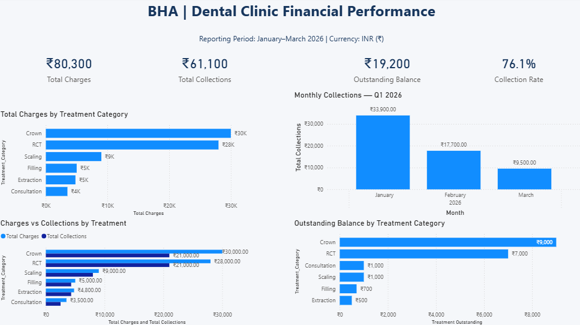

# BHA Dental Clinic Analytics
## Healthcare Financial Analytics | Python | SQL | Power BI

## Project Overview

This project demonstrates an end-to-end healthcare financial analytics workflow using fictional dental clinic transaction data for January–March 2026. It combines Excel data preparation, Python analysis, SQL queries, financial reconciliation, and a Power BI dashboard.

**Organization:** Bhardwaj Healthcare Analytics (BHA)
**Reporting period:** January–March 2026
**Currency:** INR
**Dataset:** 35 fictional transactions

> **Data disclaimer:** All records and figures are fictional and intended solely for portfolio demonstration. They do not represent actual clinic performance or real patient transactions.

## Business Questions

- What were the total charges and collections?
- What balance remained outstanding?
- What was the collection rate?
- How did collections vary by month and treatment category?
- Do Python and SQL produce consistent results?

## Key Financial Results

| Metric | Result |
|---|---:|
| Total Charges | ₹80,300 |
| Total Collections | ₹61,100 |
| Outstanding Balance | ₹19,200 |
| Collection Rate | 76.09% |
| Transactions | 35 |

## Monthly Collections

| Month | Collections |
|---|---:|
| January 2026 | ₹33,900 |
| February 2026 | ₹17,700 |
| March 2026 | ₹9,500 |
| **Total** | **₹61,100** |

Collections declined across the three months in this fictional sample. The short period does not establish a reliable real-world trend.

## Treatment-Level Analysis

| Treatment | Charges | Collections | Outstanding | Collection Rate |
|---|---:|---:|---:|---:|
| Crown | ₹30,000 | ₹21,000 | ₹9,000 | 70.00% |
| RCT | ₹28,000 | ₹21,000 | ₹7,000 | 75.00% |
| Scaling | ₹9,000 | ₹8,000 | ₹1,000 | 88.89% |
| Filling | ₹5,000 | ₹4,300 | ₹700 | 86.00% |
| Extraction | ₹4,800 | ₹4,300 | ₹500 | 89.58% |
| Consultation | ₹3,500 | ₹2,500 | ₹1,000 | 71.43% |
| **Total** | **₹80,300** | **₹61,100** | **₹19,200** | **76.09%** |

Crown and RCT together account for ₹16,000 of the ₹19,200 outstanding balance in this demonstration dataset.

## Tools and Workflow

1. **Excel:** Structured source workbook and cleaned transaction data.
2. **Python and pandas:** Data inspection, quality checks, calculations, summaries, charts, and CSV exports.
3. **SQLite and SQL:** Overall KPIs, monthly collections, and treatment-level analysis.
4. **Power BI:** DAX measures, KPI cards, and financial visualizations.
5. **Validation:** SQL outputs reconciled against Python results.

## Validation

Data-quality checks included missing values, duplicate transaction IDs, duplicate rows, and outstanding-balance calculations.

All three SQL-to-Python reconciliation checks passed:

- Overall financial KPIs
- Monthly collections
- Treatment-level financial totals

## Power BI Dashboard

Dashboard page: **Financial Performance**

- Total Charges by Treatment Category
- Monthly Collections — Q1 2026
- Charges vs Collections by Treatment
- Outstanding Balance by Treatment Category

### Dashboard Screenshot



### Project Artifacts

- [Python analysis notebook](03_Python_Analysis/BHA_Dental_Clinic_Analysis.ipynb)
- [Power BI dashboard file](04_PowerBI_Dashboard/BHA_Dental_Clinic_Analytics.pbix)
- [Python analysis report](05_Report/BHA_Dental_Clinic_Python_Analysis_Report.md)
- [SQL analysis report](04_SQL_Analysis/BHA_Dental_Clinic_SQL_Analysis_Report.md)
- [SQL scripts folder](04_SQL_Analysis/)
- [Documentation folder](07_Documentation/)

## Project Structure

```text
BHA_Dental_Clinic_Analytics/
├── 01_Raw_Data/
├── 02_Cleaned_Data/
├── 03_Python_Analysis/
├── 04_PowerBI_Dashboard/
├── 04_SQL_Analysis/
├── 05_Report/
├── 05_Reports/                  # Extra folder; currently empty
├── 06_Screenshots/
├── 07_Documentation/
└── README.md
```

The SQL folder contains the SQLite database, three reusable SQL queries, three CSV result files, and the SQL analysis report. The Python report and its CSV outputs are in `05_Report`.

## Limitations

- The dataset contains only 35 fictional transactions across three months.
- It cannot establish actual clinic performance or reliable long-term trends.
- Charges and collections do not, by themselves, establish accounting revenue or profit.
- Operating expenses, treatment costs, and insurance reimbursement are outside the current scope.

## Future Enhancements

- Add more synthetic records and reporting periods.
- Add interactive date filters and additional Power BI measures.
- Expand automated data-quality checks.
- Add cost and profitability analysis using clearly defined data.
- Publish reproducible notebooks, SQL scripts, and dashboard screenshots.

## About

Developed as a portfolio project for **Bhardwaj Healthcare Analytics (BHA)** to demonstrate healthcare data preparation, Python, SQL, financial reconciliation, and Power BI reporting.
